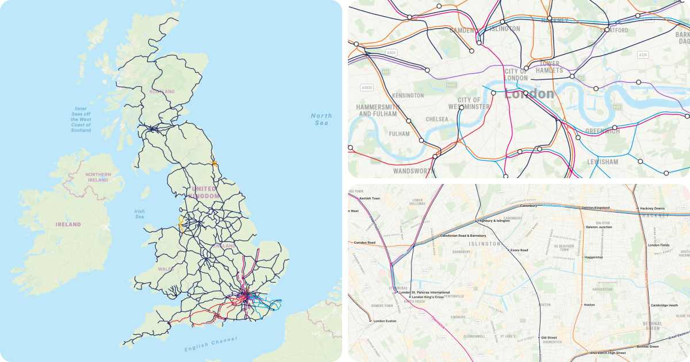

 > [!NOTE]
 > This is a work in progress, more ways to consume the data will be available soon.

# Country scale transit maps



A transit map of Britain's railways (currently England, Scotland and
Wales), built from OpenStreetMap and drawn over Apple Maps: the National
Rail network as one line, with a few networks people know by name (the
Elizabeth line, the Overground, Thameslink…) in their own colours, side by
side where they share track.

It builds one file, `out/gb.transit.json`. A web preview (`web/`) draws it,
but it's made to be drawn in an app with
[SwiftUI's MapKit](https://developer.apple.com/documentation/mapkit).

## Quick start

Needs Node 24+, osmium and cmake (`brew install node osmium-tool cmake`),
and LOOM, built as below.

```sh
npm install                  # TypeScript, for type checking
npm run osm                  # the GB extract from Geofabrik (~2 GB)
npm run build                # all of Britain: about 10 minutes, 24 GB of memory
echo APPLE_MAPKIT_TOKEN=… > .env
npm run web                  # http://localhost:8080
```

`npm run osm` downloads the extract into `vendor/osm`, or a newer one if
there is one (Geofabrik update it daily).

### Installing LOOM

The build runs two of [LOOM](https://github.com/ad-freiburg/loom)'s
programs, `topo` and `loom`, from `vendor/loom/build`. Build them there,
at the commit the map is made with (LOOM's output changes between
versions):

```sh
git clone https://github.com/ad-freiburg/loom.git vendor/loom
git -C vendor/loom checkout 1e47578
git -C vendor/loom submodule update --init --recursive
cmake -S vendor/loom -B vendor/loom/build -DCMAKE_BUILD_TYPE=Release
cmake --build vendor/loom/build -j8 --target topo loom
```

A few minutes. To try a newer LOOM, check out another commit and run the
last three lines again, then compare the map.

The web preview takes `?lat=…&lon=…&z=…` to start at a place, and
`&rot=…` to start turned.

## How it works

OpenStreetMap maps each train service as a route relation: the stops it
calls at and the ways (stretches of track) it runs on, every track mapped
separately. A transit map wants the opposite: one line per corridor, with
the services that share it side by side. The build gets from one to the
other in five steps, two of them LOOM's:

```
OSM extract
  │  linegraph.ts    services → lines; their track → a graph; stops → stations
  ▼
line graph            every track, each edge listing the lines on it
  │  topo.ts         LOOM topo: parallel tracks merged into corridors
  ▼
corridors
  │  tidy.ts         knots topo leaves untied
  │  loom            LOOM loom: lines on each corridor put in order
  ▼
ordered line graph    out/gb.map.json
  │  check.ts        every service still runs unbroken, stop to stop
  │  render.ts       the graph, line names and station dots, for maps
  ▼
out/gb.transit.json
  │  web/bundles.js
  ▼
lines drawn side by side on the map, at whatever zoom it's at
```

The map itself is drawn by the web page or app, not by the build: the
build hands them the ordered line graph, and they lay the lines side by
side in screen points for their zoom. So lines stay the same distance
apart however far you zoom.

### The steps

`npm run build` runs steps 1 to 4, the check and the track graph in turn.
Each is its own script too, to rerun from any step: its inputs are the
files the steps before it wrote.

#### Download: `npm run osm`

Geofabrik's Great Britain extract.

Writes `vendor/osm/great-britain-latest.osm.pbf`.

#### 1. Line graph: `npm run linegraph`

`map/linegraph.ts` reads every `route=train` relation (and the Tyne and
Wear Metro's `light_rail` ones) with osmium, and:

- decides each service's line (`map/lines.ts`)
- keeps just the parts of each way its trains use, split into edges at
  junctions, stops and where the lines change
- groups stops into stations (`map/lib/stationGroups.ts`)

Writes:

- `out/gb.linegraph.json`: the line graph
- `out/gb.routes.json`: each service's stops, for the check
- `out/gb.names.json`: what each stretch of line is called, for line names
- `out/gb.stations.json`: each stop's station

#### 2. Merge: `npm run topo`

`map/topo.ts` runs LOOM's `topo` to merge parallel tracks into one
corridor, in two passes: each line's own tracks first (up to about 90 m
apart), then lines where they share track (about 50 m). In one pass, lines
on different tracks close together would merge: the Elizabeth line under
Whitechapel onto the Overground above it. This takes most of the build's
time.

Writes `out/gb.topo.json`.

#### 3. Tidy and order: `npm run tidy`

`map/tidy.ts` unties the knots topo leaves (see [Tidying](#tidying)), then
LOOM's `loom` orders the lines on each corridor so they cross as little as
they can.

Writes `out/gb.map.json`.

#### Check: `npm run check`

`map/check.ts` checks every service in `out/gb.routes.json` still runs
unbroken from stop to stop on the finished graph, turning only where it
may. It lists any breaks, by line, in the build log; the build carries on
regardless.

#### 4. Render: `npm run render`

`map/render.ts` writes the ordered line graph in a compact form, line names
placed for each zoom step, and each station's dots. A few seconds.

Writes `out/gb.transit.json`.

#### Track graph: `npm run tracks`

Separately, `map/tracks.ts` splits all running track at junctions and the
stations in `STATIONS_JSON` (set in `.env`), for routing trains along real
track. Skipped if it isn't set.

Writes `out/gb.tracks.json`.

### Lines

National Rail is one line, the base network, not one per train company. A
few networks people know by name have their own line, drawn beside it where
they share track: the Elizabeth line, London Overground (one orange line
for all six), Thameslink, Southeastern, South Western Railway, Heathrow
Express, Merseyrail and the Tyne and Wear Metro.

`map/lines.ts` decides it all (`serviceLine`): London's lines by their
route `ref` (`Windrush` → London Overground), companies by `brand`, name,
`operator` or `network`, matched against `TRAIN_COMPANIES`, which lists the
other names OSM uses for each (old names, owners, misspellings). Companies
in `OWN_LINES` get their own line; the rest are National Rail, as are
routes of no known company tagged as National Rail's or Network Rail's (the
Felixstowe branch). Other routes (heritage railways, charters, mistagged
track) are left out and listed in the build log. Elizabeth line services
that never enter its tunnel under central London are drawn as National
Rail, as on TfL's map (`TUNNEL_STOPS`). `LINES` sets each line's colour.

### Stations

A station's stops (its platforms, often each their own OSM node) are
grouped by National Rail's CRS codes (`ref:crs`): a stop's own, its stop
area's, or else the nearest coded station's of its name (within 1 km) or
of any name (within 200 m, for stops with no name or a misspelt one). Codes
of one station are grouped too (St Pancras's STP and SPL), and stations are
named after their coded station. Stops with no code (the Tyne and Wear
Metro's) are grouped by name. Later steps join and match a station's stops
by this (`out/gb.stations.json`), not by name and distance.

Each stop stays its own node through topo: given one node for a station,
topo runs every line calling there through it, which pulls lines off their
track where a station's platforms are apart (Whitechapel's Elizabeth line,
deep under the Overground). Tidy joins those linked by track.

### Tidying

Topo only merges tracks so far apart, so where they split for a short way
(twin tunnels at a junction, fast and slow lines in separate tunnels,
flyovers) they'd be drawn as loops, lines running apart and back together,
or tangles of junctions. `map/tidy.ts` repeats four passes until none
changes anything:

1. **Join stops**: a station's stops linked by under 400 m of track
   become one node, or under 1.5 km at a terminus, so its lines run in
   together (Liverpool Street).
2. **Join junctions** linked by under 200 m of track.
3. **Merge parallel ways**: of short ways about as long between the same
   two nodes, the shortest is kept, carrying all their lines.
4. **Drop bypasses**: a way with no stations whose lines all also run on a
   route with stations within 500 m and about as long goes (the Redhill
   avoiding line), so its lines are drawn once, through the stations.

Then it tidies turn restrictions (which turns a line can't make at a
junction, as topo inferred them), lifting any that a service shows are
wrong, so every service is drawn as one unbroken line. Each pass visibly
changes the map; the build log says how many of each it made, and lists
the bypasses dropped.

### Drawing

`web/bundles.js` draws the lines from the ordered line graph for a zoom:
each edge's lines are offset from its centreline, in loom's order; lines
going on through a node are cut back from it and joined through it with a
curve; and each colour's pieces are joined into as few lines as they'll go
(about 500 for all of Britain). It takes about 30 ms, so maps redraw as
they zoom: every half level from zoom 12, every whole level further out,
from zoom 5 to 19.

Lines are 3.5 pt apart (centre to centre) at zoom 14, twice as far apart
two levels in and half two levels out, but never closer than 3 pt, and
half as wide as they're apart, up to 3 pt (`LINE_POINTS`, `PITCH_POINTS`
and `MIN_PITCH_POINTS` in `map/render.ts`, which maps read from
`gb.transit.json`).

Line names are placed by the build for each zoom step from zoom 11, along
the track, clear of each other and of stations, with the side their line is
drawn on, for maps to move each name onto its line. National Rail is called
by its track's name (West Coast Main Line), the Overground by each of its
lines' (Windrush line), the others by their own.

Station dots show from zoom 10, a dot on each line calling there from zoom
13, named from zoom 12.

## Where things are

```
map/                 the build, a file for each step
  linegraph.ts topo.ts tidy.ts check.ts render.ts tracks.ts
  lines.ts           which lines there are, their colours, and which line
                     each service is
  lib/               what the steps share
    osm.ts           reading the extract with osmium
    geo.ts           geometry: distances, simplifying, encoding lines
    graph.ts         the line graph's types, walking and searching it
    stationGroups.ts grouping stops into stations
    routes.ts        services stop to stop, on the line graph
    stations.ts      station dots, for render.ts
    labels.ts        placing line names, for render.ts
web/                 the web preview
  serve.ts           serves the page, the built map and the MapKit token
  map.js             shows the map on MapKit JS
  bundles.js         draws lines side by side
out/                 what the build writes (not in git)
vendor/              LOOM and the OSM extract (not in git)
```

## Changing things

| To change | Edit | Then run |
|---|---|---|
| Which line a service is, or a new company name | `map/lines.ts` | `npm run build` |
| A line's colour | `LINES` in `map/lines.ts` | `npm run render` |
| How close tracks merge | `map/topo.ts` | `npm run topo`, `tidy`, `check`, `render` |
| Tidying | `map/tidy.ts` | `npm run tidy`, `check`, `render` |
| Line width, spacing, line names' zooms | `map/render.ts` | `npm run render` |
| How lines are drawn | `web/bundles.js`, and any app's port of it | reload the page |

`npm run typecheck` checks the build's types. Code separates each step in a
function with a blank line.

Tidy's output is the same every run, byte for byte, so a change to it can
be checked by comparing. LOOM's `topo` and `loom` vary a little from run to
run, so theirs can't: compare it on the map instead.

## Output

`out/gb.transit.json` is the map in one compact file: the ordered line
graph, line names for each zoom step, and each station's position,
direction and the colours of the lines calling there, for its dots. Its
format is at the top of `map/render.ts`.

`out/gb.map.json` is LOOM's GeoJSON line graph: `LineString` edges with
`from`, `to` and an ordered `lines` array (`id`, `label`, `color`), and
`Point` nodes, with `station_id` and `station_label` for stations. The first
line in an edge's `lines` is drawn furthest right, looking from `from` to
`to`.

## Licences

This project is MIT. [LOOM](https://github.com/ad-freiburg/loom) is GPL-3.0
and is fetched and run as a separate program, not bundled. Map data ©
OpenStreetMap contributors, ODbL.
